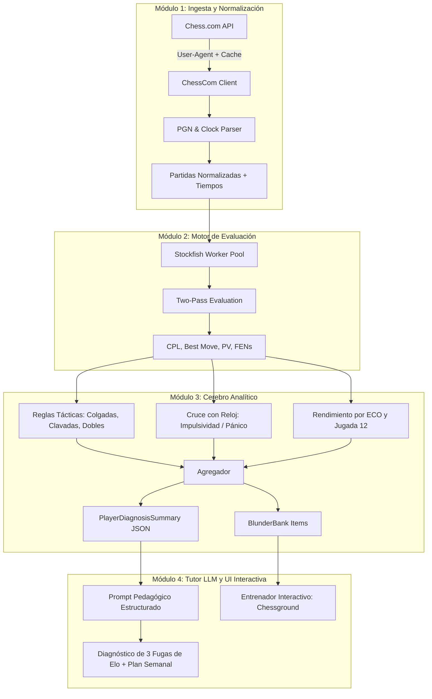

# Guía General del Proyecto: Profesor Personal de Ajedrez con IA & Chess.com

## 1. Visión y Propósito
El **Profesor Personal de Ajedrez** es una plataforma web inteligente diseñada para analizar las partidas reales de un usuario en Chess.com, identificar de forma determinista y matemática sus errores más recurrentes, clasificar los motivos tácticos y psicológicos que causan pérdidas de Elo, y entregar un diagnóstico pedagógico accionable junto con un plan de estudio y un entrenador interactivo de errores propios (*Blunder Replay*).

---

## 2. Reglas de Oro Arquitectónicas (Restricciones Críticas)

1. **Separación Estricta entre Cálculo (Stockfish) y Pedagogía (LLM):**
   - **Prohibido enviar PGNs completos al LLM:** Los modelos de lenguaje alucinan posiciones, no calculan variantes tácticas profundas ni evalúan con precisión matemática el material y la actividad.
   - **Cálculo Determinista:** La evaluación en centipeones (CPL), mejor jugada, variantes principales (PV) y legalidad de movimientos recae exclusivamente en **Stockfish 16+** y `python-chess`.
   - **Pedagogía Estructurada:** El LLM recibe única y exclusivamente un objeto JSON agregado (`PlayerDiagnosisSummary`) con estadísticas procesadas para redactar el diagnóstico, priorizar temas y formular pistas pedagógicas.

2. **Requisitos de la API Pública de Chess.com:**
   - Toda petición HTTP a `https://api.chess.com/pub/...` incluye obligatoriamente el header:
     `User-Agent: ChessTutor/1.0 (contacto@tuapp.com)` para evitar bloqueos (HTTP 403).
   - Implementación de caché local (SQLite) para evitar re-descargas innecesarias de archivos PGN mensuales ya finalizados.
   - Manejo de rate-limiting preventivo.

3. **Extracción y Psicología del Reloj:**
   - Los PGN de Chess.com contienen etiquetas de tiempo `[%clk H:MM:SS]` en cada movimiento.
   - El sistema calcula el tiempo consumido ($\Delta t$) en cada turno y lo cruza con la gravedad del error (CPL), permitiendo diagnosticar:
     - **Juego Impulsivo:** Blunders realizados en $\le 3\text{ s}$ teniendo más de 2 minutos en el reloj.
     - **Pánico por Apuro de Tiempo:** Errores graves cometidos con menos de 10-15 segundos disponibles.

---

## 3. Pipeline de 4 Módulos



### Módulo 1: Ingesta y Normalización (Chess.com Connector)
- **Entrada:** `username` de Chess.com, ritmo (`rapid`, `blitz`, `bullet`), número de partidas $N$.
- **Proceso:** Descarga de perfil (`/pub/player/{username}`), estadísticas (`/stats`) y archivos mensuales (`/games/YYYY/MM`).
- **Salida:** Partidas normalizadas con metadatos (color del usuario, Elo, resultado, código ECO, control de tiempo) y secuencia de jugadas con marcas de reloj exactas y $\Delta t$ calculado por turno.

### Módulo 2: Motor de Evaluación (Stockfish Worker)
- **Entrada:** Secuencia de posiciones de las partidas del Módulo 1.
- **Estrategia Two-Pass Smart Engine:**
  - *Fase 1 (Rápida):* Profundidad 11 (~30ms/jugada) para trazar la curva de centipeones y detectar caídas bruscas.
  - *Fase 2 (Focalizada):* Profundidad 16 (~200ms) solo en posiciones donde la pérdida de centipeones (CPL) supera los 50 puntos o se omiten mates.
- **Salida:** Registro de jugadas críticas: FEN previo, jugada del usuario, mejor jugada del motor, variante principal (PV), CPL y clasificación:
  - *Inexactitud:* CPL entre 50 y 100.
  - *Error:* CPL entre 100 y 200.
  - *Blunder:* CPL > 200 o pérdida de ventaja decisiva/mate forzado.

### Módulo 3: Clasificador Heurístico y Detector de Patrones (Cerebro Analítico)
- **Heurísticas Tácticas deterministas (`python-chess`):**
  - **Pieza Colgada (*Hanging Piece*):** Casilla ocupada o atacada por el rival sin suficiente defensa táctica o intercambio con balance negativo de material.
  - **Clavada Táctica (*Pin Exploitation*):** Verificado con `board.is_pinned()`. Jugadas que exponen piezas de mayor valor detrás.
  - **Ataque Doble / Horquilla (*Fork*):** Casillas donde una pieza rival ataca simultáneamente a 2 piezas de mayor o igual valor.
  - **Mate Omitido (*Missed Mate*):** Secuencias de mate forzado en 1 a 3 jugadas no aprovechadas.
  - **Seguridad del Rey:** Rey retenido en el centro después de la jugada 15 con columnas abiertas o ruptura de peones del enroque.
- **Heurísticas Psicológicas y de Apertura:**
  - Relación entre velocidad de ejecución y gravedad del error.
  - Rendimiento por código ECO evaluando winrate y evaluación media alcanzada al salir de la jugada 12.
- **Salida:** `PlayerDiagnosisSummary` (JSON) y posiciones para el `BlunderBank`.

### Módulo 4: Tutor IA y Entrenador Interactivo (LLM + UI)
- **Diagnóstico del Tutor:** El LLM genera una devolución humana, empática y rigurosa basada en los 3 problemas principales que más Elo le cuestan al jugador.
- **Plan de Estudio Semanal:** Tareas concretas divididas por días (ej. táctica de clavadas, ajuste de repertorio frente a 1.e4).
- **Entrenador Interactivo (*Blunder Replay*):** Tablero interactivo donde el usuario debe encontrar la jugada correcta en las posiciones donde falló en sus partidas, con 3 niveles de pistas pedagógicas progresivas:
  1. *Conceptual:* Pista estratégica sobre qué pieza o casilla mirar.
  2. *Direccional:* Enfoque hacia la debilidad concreta o patrón táctico.
  3. *Concreta:* Revelación del movimiento clave y explicación de la variante ganadora.

---

## 4. Stack Tecnológico Seleccionado

| Componente | Tecnología | Justificación |
| :--- | :--- | :--- |
| **Backend** | Python 3.12 + FastAPI | Ecosistema nativo de `python-chess`, excelente soporte asíncrono para streaming SSE y validación estricta con Pydantic V2. |
| **Motor de Ajedrez** | Stockfish 16+ UCI | Motor número 1 del mundo, integrado mediante pool asíncrono local con concurrencia controlada (`asyncio.Semaphore`). |
| **Frontend** | Next.js 15 (React 19) + TypeScript | Alto rendimiento, App Router moderno, Tailwind CSS para UI responsiva y soporte de Server Components. |
| **Tablero de Ajedrez** | Chessground + chess.js | `chessground` (Lichess) garantiza 60 fps, animaciones táctiles fluidas y dibujo nativo de flechas. `chess.js` valida legalidad en cliente. |
| **Caché y Persistencia** | SQLite con modo WAL | Cero sobrecarga de infraestructura en desarrollo y MVP; lectura/escritura concurrente para PGNs y caché de FENs evaluados. |
| **Visualización** | Recharts / Tremor | Gráficas de dispersión tiempo vs. error, distribución de blunders por fase de juego y tablas de aperturas. |
| **LLM** | OpenAI / Anthropic / Gemini via Structured Outputs | Garantía de formato JSON sin alucinaciones estructurales. |

---

## 5. Contratos de Datos Principales

### 5.1. `PlayerDiagnosisSummary` (Insumo para el LLM)
```json
{
  "player": {
    "username": "ejemplo_user",
    "elo_current": 1450,
    "time_class": "rapid",
    "games_analyzed": 30,
    "period": "2026-09 to 2026-10"
  },
  "overall_metrics": {
    "win_rate": 0.53,
    "draw_rate": 0.07,
    "loss_rate": 0.40,
    "avg_centipawn_loss": 58.4,
    "accuracy_score": 76.2
  },
  "error_breakdown": {
    "blunders_total": 24,
    "errors_total": 41,
    "inaccuracies_total": 68,
    "blunders_per_game": 0.80
  },
  "phase_distribution": {
    "opening": { "blunders": 3, "avg_cpl": 22.1, "percentage_of_blunders": 12.5 },
    "middlegame": { "blunders": 16, "avg_cpl": 68.3, "percentage_of_blunders": 66.7 },
    "endgame": { "blunders": 5, "avg_cpl": 45.0, "percentage_of_blunders": 20.8 }
  },
  "tactical_motifs": {
    "hanging_piece": { "count": 11, "percentage_of_blunders": 45.8, "description": "Piezas colgadas o mal protegidas" },
    "pin_exploitation": { "count": 5, "percentage_of_blunders": 20.8, "description": "Fallo al advertir clavadas al rey o piezas mayores" },
    "fork_overlooked": { "count": 4, "percentage_of_blunders": 16.7, "description": "Ataques dobles no detectados" },
    "missed_mate": { "count": 2, "percentage_of_blunders": 8.3, "description": "Omisión de mate en 1 a 3 jugadas" },
    "king_safety_collapse": { "count": 2, "percentage_of_blunders": 8.3, "description": "Rey vulnerable sin enrocar o enroque roto" }
  },
  "clock_psychology": {
    "blunders_under_3s_with_ample_time": 9,
    "blunders_in_time_trouble_under_10s": 7,
    "primary_flaw": "impulsive_play",
    "avg_time_on_blunders_seconds": 3.1,
    "avg_time_on_good_moves_seconds": 18.5,
    "blunder_time_ratio": 0.17
  },
  "opening_repertoire_gaps": [
    {
      "eco": "B01",
      "name": "Scandinavian Defense",
      "color": "black",
      "games_played": 7,
      "win_rate": 0.14,
      "avg_eval_at_move_12": -2.15,
      "dominant_blunder_motif": "hanging_piece"
    }
  ],
  "top_3_algorithmic_flags": [
    {
      "code": "HANGING_PIECES_MIDGAME",
      "severity": "CRITICAL",
      "metric_reference": "45.8% de los blunders son piezas colgadas en medio juego"
    },
    {
      "code": "IMPULSIVE_MOVE_SELECTION",
      "severity": "HIGH",
      "metric_reference": "9 blunders graves ejecutados en menos de 3s con más de 4 minutos disponibles"
    },
    {
      "code": "REPERTOIRE_LEAK_B01",
      "severity": "HIGH",
      "metric_reference": "La Defensa Escandinava genera desventaja de -2.15 en la jugada 12 con solo 14% de victorias"
    }
  ]
}
```

### 5.2. `BlunderBankItem` (Insumo para el Entrenador Interactivo)
```json
{
  "id": "blk_game_987654_m18_white",
  "game_url": "https://www.chess.com/game/live/987654",
  "metadata": {
    "white": "ejemplo_user",
    "black": "rival_123",
    "user_color": "white",
    "eco": "B01",
    "opening_name": "Scandinavian Defense: Mieses-Kotroc",
    "time_control": "600"
  },
  "move_number": 18,
  "turn": "white",
  "fen_before": "r3k2r/pp1nbppp/2p1pn2/q7/2B5/2NP1N2/PPP2PPP/R1BQR1K1 w kq - 3 10",
  "user_move": {
    "uci": "c1g5",
    "san": "Bg5??",
    "time_spent_seconds": 2.1,
    "clock_remaining_seconds": 380
  },
  "engine_solution": {
    "best_move_uci": "c4e6",
    "best_move_san": "Bxe6!",
    "eval_before": +1.40,
    "eval_after_user_move": -1.20,
    "cpl": 260,
    "pv_uci": ["c4e6", "f7e6", "e1e6", "e8f7"],
    "pv_san": ["Bxe6!", "fxe6", "Rxe6", "Kf7"]
  },
  "classification": {
    "phase": "middlegame",
    "theme": "hanging_piece",
    "psychological_tag": "impulsive"
  },
  "tutor_hints": {
    "level_1_conceptual": "¿Qué pieza negra importante está expuesta en e7 o a5?",
    "level_2_directional": "Fíjate en la debilidad de la casilla e6 y el rey negro sin enrocar.",
    "level_3_concrete": "Sacrifica el alfil con Bxe6!, rompiendo la estructura de peones y explotando la falta de enroque."
  }
}
```

